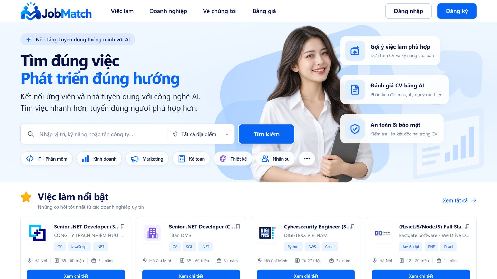
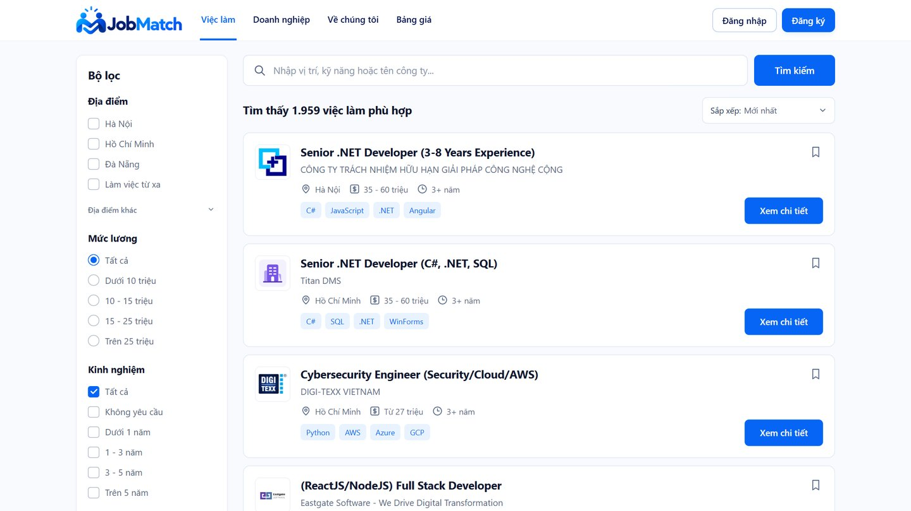
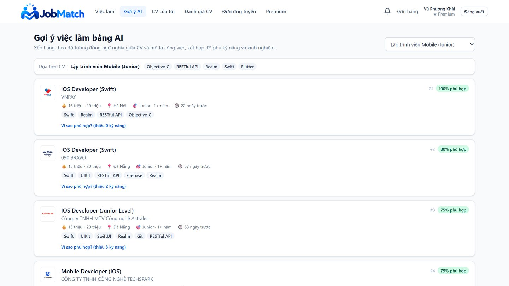
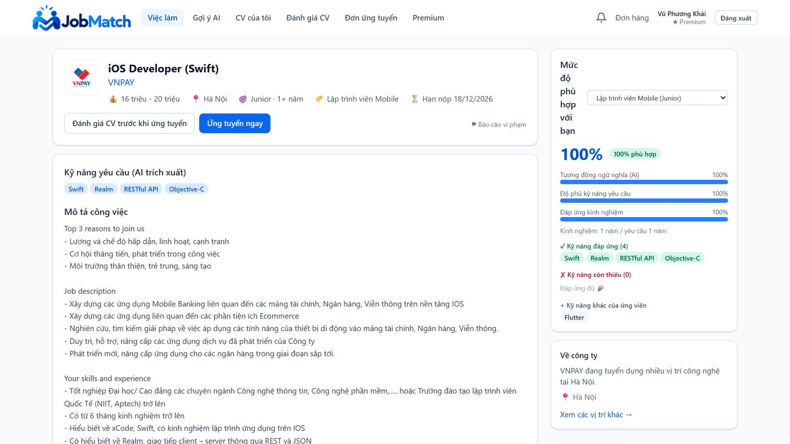
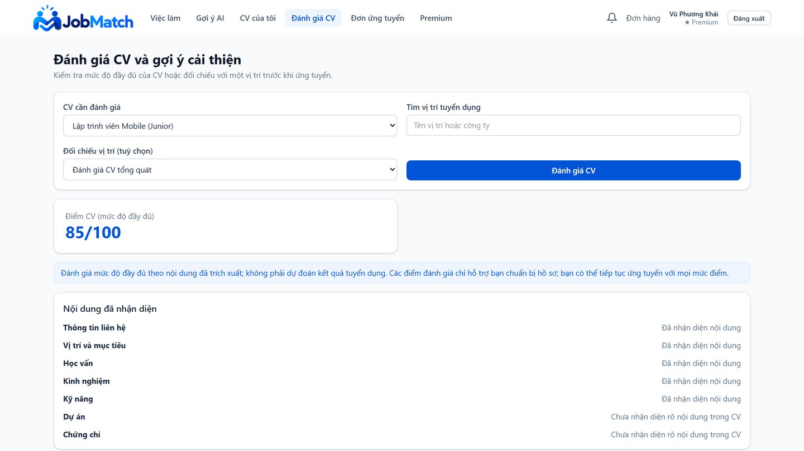
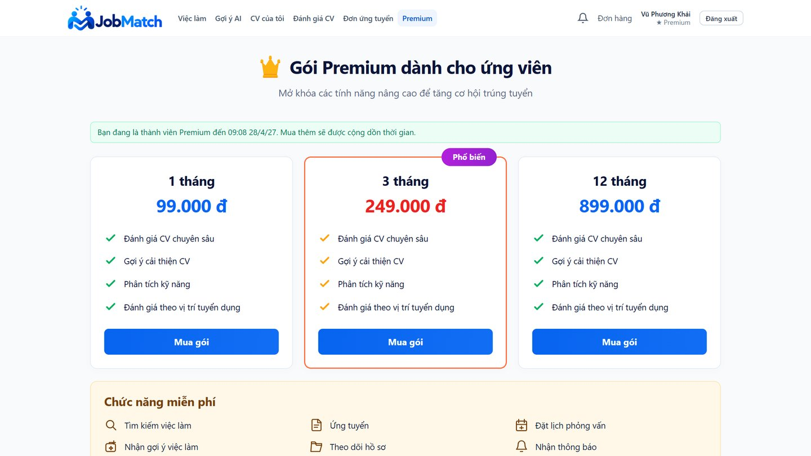
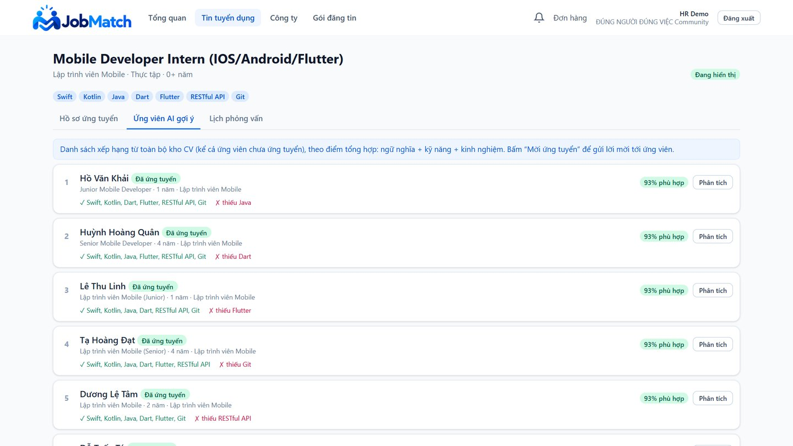
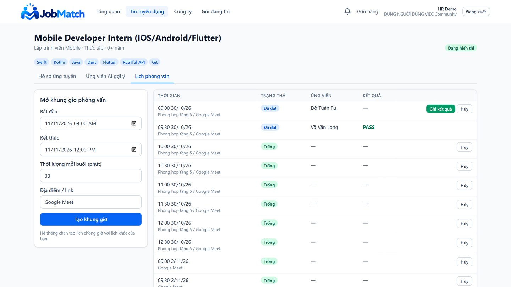
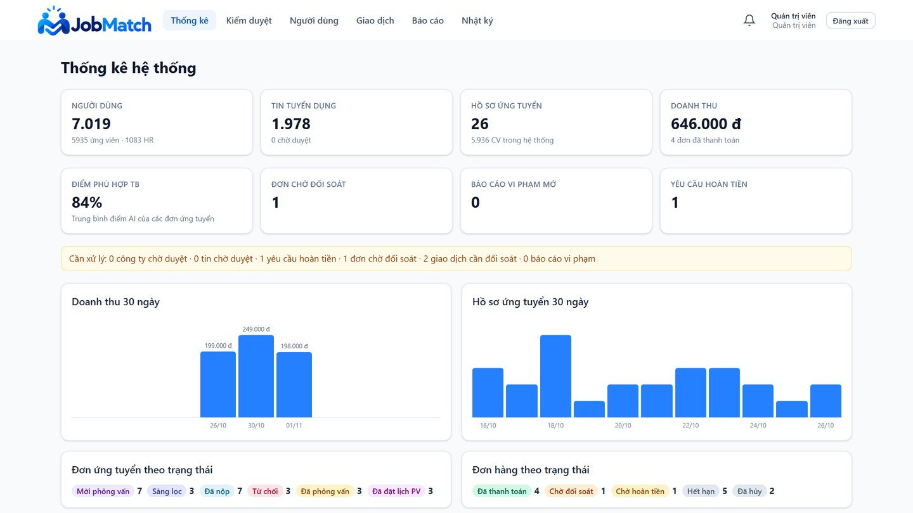

<p align="center">
  
</p>

<h3 align="center">Tìm đúng việc · Tuyển đúng người</h3>

<p align="center">
  Nền tảng tuyển dụng thông minh hai chiều, dùng AI để so khớp CV với tin tuyển dụng
</p>

<p align="center">
  
  
  
  
  
</p>

<p align="center">
  
</p>

> 🔒 Đây là trang giới thiệu dự án. Mã nguồn được lưu ở kho riêng tư. Xem mục [Mã nguồn](#mã-nguồn) nếu bạn cần xem code.

---

## JobMatch là gì?

Trên các trang tuyển dụng phổ biến, ứng viên phải tự lọc hàng trăm tin. Nhà tuyển dụng thì đọc thủ công từng CV. Việc tìm kiếm chủ yếu dựa vào từ khóa, nên "ReactJS" và "React.js" có thể bị xem là hai kỹ năng khác nhau. Một CV tốt vẫn có thể bị bỏ sót chỉ vì cách viết khác đi.

**JobMatch** giải quyết vấn đề này bằng cách để AI **hiểu nội dung** của CV và tin tuyển dụng, rồi gợi ý theo **cả hai chiều**:

- **Ứng viên** nhận danh sách việc làm phù hợp nhất với CV của mình, kèm giải thích vì sao phù hợp và còn thiếu kỹ năng gì.
- **Nhà tuyển dụng** nhận danh sách ứng viên tiềm năng cho từng tin, kể cả những người chưa nộp đơn.

Toàn bộ quy trình tuyển dụng nằm trên một nền tảng, từ đăng tin, ứng tuyển, đặt lịch phỏng vấn đến thanh toán.

## Tính năng nổi bật

### Dành cho ứng viên
- **Tải CV lên, AI tự đọc:** hệ thống trích xuất thông tin cá nhân, kinh nghiệm, học vấn và kỹ năng từ file PDF/DOCX.
- **Gợi ý việc làm bằng AI:** việc làm được xếp hạng theo mức độ phù hợp với CV, có phần trăm phù hợp rõ ràng.
- **Phân tích khoảng cách kỹ năng:** cho biết kỹ năng nào đã đáp ứng, kỹ năng nào còn thiếu so với từng vị trí.
- **Đánh giá CV và gợi ý cải thiện:** chấm điểm mức độ đầy đủ của CV và chỉ ra phần cần bổ sung.
- **Ứng tuyển và tự chọn lịch phỏng vấn:** chọn khung giờ trống do nhà tuyển dụng mở. Khung giờ được giữ chỗ 10 phút để không bị người khác chọn trùng.
- **Gói Premium (1, 3 hoặc 12 tháng):** mở khóa đánh giá CV chuyên sâu, gợi ý cải thiện và đối chiếu với vị trí tuyển dụng, thanh toán bằng mã VietQR.

### Dành cho nhà tuyển dụng
- **Đăng và quản lý tin tuyển dụng:** lưu nháp, đăng, đóng hoặc mở lại tin.
- **Ứng viên AI gợi ý:** xem ngay những ứng viên phù hợp nhất cho từng tin, kèm kỹ năng khớp và kỹ năng thiếu.
- **Quản lý hồ sơ ứng tuyển:** chuyển trạng thái từ sàng lọc đến phỏng vấn và kết quả, ứng viên được thông báo tự động.
- **Mở lịch phỏng vấn:** tạo các khung giờ để ứng viên tự đặt, không cần trao đổi qua lại.
- **Gói đăng tin:** mua thêm lượt đăng tin, thanh toán tự động xác nhận qua SePay.

### Dành cho quản trị viên
- **Bảng thống kê:** người dùng, tin tuyển dụng, hồ sơ, doanh thu theo thời gian.
- **Kiểm duyệt:** duyệt công ty, xử lý báo cáo vi phạm.
- **Đối soát thanh toán:** theo dõi giao dịch, xử lý đơn chờ đối soát và yêu cầu hoàn tiền.

## AI so khớp hoạt động thế nào?

```text
  CV / Tin tuyển dụng
          │
          ▼
  ① Đọc hiểu      →  trích xuất kỹ năng, kinh nghiệm, vị trí
          │
          ▼
  ② Hiểu ngữ nghĩa →  mô hình E5 (đã tinh chỉnh cho tiếng Việt và CV–JD)
          │            chuyển nội dung thành vector để so sánh ý nghĩa
          ▼
  ③ Tìm nhanh      →  lọc ra 200 kết quả gần nhất trong cơ sở dữ liệu vector
          │
          ▼
  ④ Chấm điểm      →  kết hợp: độ giống ngữ nghĩa + mức phủ kỹ năng + kinh nghiệm
          │
          ▼
  Danh sách gợi ý  +  giải thích kỹ năng đã có / còn thiếu
```

Mô hình được huấn luyện và đánh giá trên **1.978 tin tuyển dụng**, **5.934 CV** thuộc **16 nhóm ngành**, với bộ từ điển **384 kỹ năng**.

| Chỉ số | Kết quả |
|---|---|
| Độ chính xác xếp hạng (NDCG@10), mô hình gốc → sau tinh chỉnh | 0,630 → **0,842** (tăng 34%) |
| NDCG@10 khi kết hợp chấm điểm kỹ năng và kinh nghiệm | **0,905** |
| Không bỏ sót kết quả phù hợp trong Top-50 (Recall@50) | **0,999** |
| Độ chính xác trích xuất thông tin từ CV (F1) | **0,951** |

## Giao diện

### Ứng viên

<table>
  <tr>
    <td width="50%"><br><sub><b>Tìm việc làm</b> với bộ lọc địa điểm, mức lương, kinh nghiệm</sub></td>
    <td width="50%"><br><sub><b>Gợi ý việc làm bằng AI</b>, xếp hạng theo mức độ phù hợp</sub></td>
  </tr>
  <tr>
    <td><br><sub><b>Phân tích mức độ phù hợp</b>, kỹ năng đáp ứng và còn thiếu</sub></td>
    <td><br><sub><b>Đánh giá CV</b>, chấm điểm và gợi ý cải thiện</sub></td>
  </tr>
  <tr>
    <td colspan="2"><br><sub><b>Gói Premium</b> cho ứng viên</sub></td>
  </tr>
</table>

### Nhà tuyển dụng và quản trị viên

<table>
  <tr>
    <td width="50%"><br><sub><b>Ứng viên AI gợi ý</b> cho từng tin tuyển dụng</sub></td>
    <td width="50%"><br><sub><b>Mở khung giờ phỏng vấn</b> để ứng viên tự đặt lịch</sub></td>
  </tr>
  <tr>
    <td colspan="2"><br><sub><b>Bảng thống kê</b> dành cho quản trị viên</sub></td>
  </tr>
</table>

## Công nghệ sử dụng

| Thành phần | Công nghệ |
|---|---|
| Giao diện | React, TypeScript, Vite, Tailwind CSS |
| Máy chủ | FastAPI (Python), Celery, Redis |
| Cơ sở dữ liệu | PostgreSQL + pgvector (tìm kiếm vector) |
| AI | Sentence Transformers, mô hình multilingual-E5 tinh chỉnh |
| Thanh toán | VietQR qua SePay (xác nhận tự động bằng webhook) |
| Triển khai | Docker Compose, Nginx, GitHub Actions |

## Mã nguồn

Mã nguồn, dữ liệu và mô hình AI của JobMatch được lưu ở kho riêng tư. Nếu bạn là giảng viên, nhà tuyển dụng hoặc đối tác cần xem code, vui lòng liên hệ qua email bên dưới để được cấp quyền truy cập.

## Tác giả

Đồ án chuyên ngành, ngành Kỹ thuật phần mềm, Trường Đại học Phenikaa.

- **Sinh viên thực hiện:** Đỗ Trịnh Lệ Quyên
- **Giảng viên hướng dẫn:** TS. Mai Thuý Nga
- **Liên hệ:** quyendotrinhle@gmail.com

---

<sub>© 2026 Đỗ Trịnh Lệ Quyên. Mọi quyền được bảo lưu. Nội dung, hình ảnh và ý tưởng trong kho này không được sao chép hoặc sử dụng lại khi chưa có sự đồng ý của tác giả.</sub>
